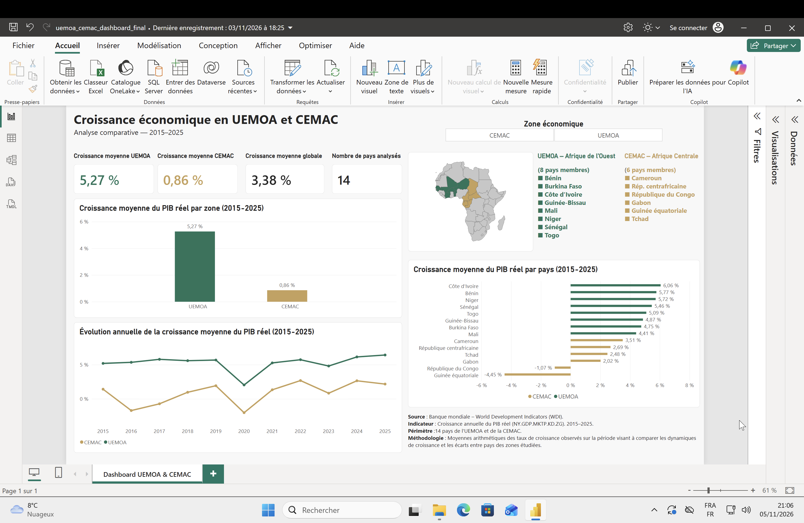

# Dashboard Power BI — Convergence UEMOA / CEMAC

## 1. Présentation

Ce tableau de bord Power BI s’inscrit dans le cadre du projet d’analyse de la convergence économique entre les pays de l’Union économique et monétaire ouest-africaine (UEMOA) et de la Communauté économique et monétaire de l’Afrique centrale (CEMAC).

Il permet de comparer les dynamiques de croissance économique des deux espaces régionaux sur la période 2015–2025, de visualiser les écarts entre les pays et d’observer leur évolution dans le temps.

## 2. Indicateur étudié

L’analyse présentée dans le tableau de bord porte sur la croissance annuelle du PIB réel.

- **Indicateur :** croissance du PIB réel (en % annuel).
- **Code Banque mondiale :** `NY.GDP.MKTP.KD.ZG`.
- **Période :** 2015–2025.
- **Couverture :** 14 pays, répartis entre l’UEMOA et la CEMAC.
- **Nombre d’observations :** 154.

## 3. Contenu du tableau de bord

Le rapport comprend notamment :

- Des indicateurs clés présentant les taux moyens de croissance de l’UEMOA, de la CEMAC et de l’ensemble des pays étudiés, ainsi que le nombre de pays couverts.
- Une comparaison de la croissance moyenne entre les deux espaces économiques.
- Une visualisation de l’évolution annuelle de la croissance du PIB réel.
- Un classement des pays selon leur croissance moyenne sur la période.
- Une carte permettant de situer les pays étudiés.
- Un segment permettant de filtrer les résultats par zone économique.

## 4. Méthodologie

Les moyennes affichées dans le tableau de bord sont calculées à partir des taux de croissance annuels des pays étudiés.

Il s’agit de moyennes arithmétiques simples, non pondérées par le poids du PIB de chaque pays. Elles servent à comparer les performances et les dynamiques de croissance des pays et des deux espaces régionaux.

Les résultats doivent donc être interprétés comme des moyennes des taux nationaux et non comme des taux de croissance agrégés officiels de l’UEMOA ou de la CEMAC.

## 5. Modèle de données

Le modèle Power BI repose sur deux tables :

- `dim_pays` : informations descriptives sur les pays, notamment leur appartenance à une zone économique.
- `fact_indicateurs` : observations des indicateurs économiques par pays et par année.

La table de faits est reliée à la table des pays à l’aide de l’identifiant `id_pays`.

## 6. Source des données

Les données proviennent de la base **World Development Indicators (WDI)** de la Banque mondiale.

Indicateur utilisé : `NY.GDP.MKTP.KD.ZG`.

Le projet Power BI modifiable lit les tables `dim_pays` et `fact_indicateurs` dans le classeur [`modele_powerbi_uemoa_cemac.xlsx`](https://github.com/divinngonda/convergence-uemoa-cemac/blob/5424844bc8d1d24b89ee4d1fa12cc4003081fa6e/02_Donnees_Nettoyees/modele_powerbi_uemoa_cemac.xlsx). La source est une URL publique du dépôt, épinglée sur le commit `5424844`; elle ne dépend pas d'un chemin local propre à une machine. L'actualisation nécessite une connexion Internet.

## 7. Outils utilisés

- Microsoft Excel : préparation et structuration des données.
- Microsoft Power BI Desktop : modélisation, mesures DAX et visualisation.
- DAX : création des mesures utilisées dans le rapport.

## 8. Fichiers du projet

- `apercu_dashboard.png` : capture réelle de la page principale du rapport.
- `01_Livrable_Final/` : version finale du rapport au format `.pbix`.
- `02_Projet_PowerBI/` : projet Power BI au format `.pbip`, accompagné des dossiers `.Report` et `.SemanticModel`.

## 9. Ouverture du rapport

Pour consulter le tableau de bord, ouvrir le fichier `.pbix` situé dans `01_Livrable_Final/` avec Power BI Desktop.

Le dossier `02_Projet_PowerBI/` contient la version projet `.pbip` et ses fichiers associés. Pour actualiser les données, ouvrir `uemoa_cemac_dashboard.pbip` dans Power BI Desktop, puis lancer **Accueil > Actualiser**. Si Power BI demande le type de connexion à la source Web GitHub, choisir **Anonyme**; si un niveau de confidentialité est demandé, choisir **Public**. Le classeur est public et ne demande pas de compte. Une connexion Internet est nécessaire pour l'actualisation. La source est figée sur le commit `5424844` afin que les résultats restent reproductibles même si le fichier de données évolue ensuite.
